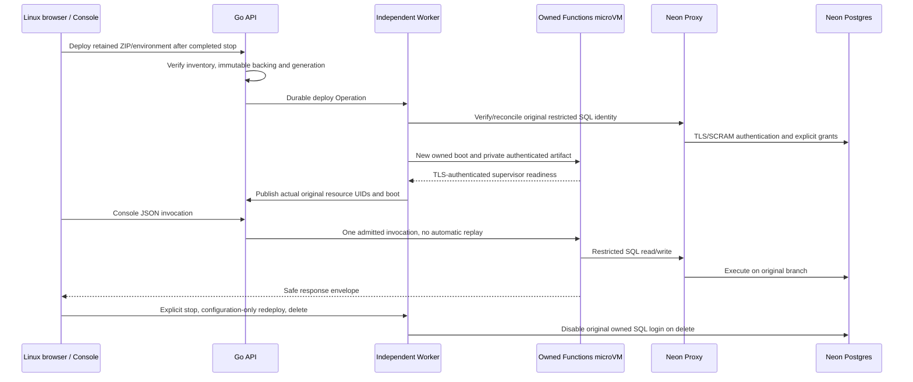

# Native Functions: actual Linux UI acceptance

## 1. Result and exact version

**Pass, as a preview product slice.** Runtime/source
`bf0dd9e41f9d3d65e321958d16c0c255f8a8b2ad`, unified Helm 0.1.19, separate Go
API/Worker and React Console. Linux browser Job `publication-ui-20261012064704`
completed on 2026-10-12 at 06:48:07 UTC. This is an explicit continuation of the
original failed fixture, not a claimed fresh-install first pass or full Neon GA.

Public CI `38212771326`: 13 successful jobs, 722 Go/PostgreSQL passing checks,
zero failures/skips. Eight artifacts were collected, seven immutable OCI
references independently verified anonymously on Linux, and 21 imports completed
serially on the three nodes. Ten-chart QA, enabled Functions private key/RBAC/TLS
rendering, 21 negative settings, packaging and eight-stage stack deployment
passed. Business Secret/PVC identities and original configuration were preserved.

## 2. Actual product path

The successful continuation recorded 15 checkpoints, including:

- Original failed Operation/bundle/definition and completed-stop identity checks;
  project/database/grants and stop mutations were not repeated.
- Retained ZIP/environment deployment into an actual new microVM and publication.
- Real Proxy TLS SQL identity/read and one actual Neon SQL write.
- Another schema's permission denial; customer HTML cannot execute on the
  Console origin; application HTTP 500 remains visible inside the safe envelope.
- Manual original VM/Runner retirement, then environment-only redeployment with
  unchanged SQL role and the previously written row.
- Function deletion followed by independent UI SQL observations: original role
  `rolcanlogin=false`, user table row count remains one.
- Completed Compute suspended through the UI; final collector observed no
  managed Compute VM or Runner Pod. No user data or failure files were deleted.

## 3. Failures retained and corrections

| Actual failure | Correction and recovery |
|---|---|
| HTTP Console lacks `crypto.randomUUID` | Existing CSPRNG helper; continue original project/grants |
| Test observed REST before login completed | Await actual logged-in UI before authenticated reads |
| Existing Proxy CA omits KeyUsage | Standards-compatible signing rule; verified TLS and negative tests |
| Controller adds immutable QMP CPU mode | Explicit complete VM specification; foreign/missing mode rejected |
| One-shot guest bootstrap already failed | Acknowledge stop; normal original UID/Runner retirement before new boot |
| Worker denied Service deletion | Conditional Worker-only namespace role; real authorization checks |
| Retained nonempty environment inventory omitted | Complete typed hydration; keep MAC/UID/names validation |

The earlier failed Jobs, protected fixtures, deployment history, source/OCI
receipts and Linux evidence remain retained. Focused test fixture corrections
and an initial post-upgrade audit of Helm history GC are reported separately;
neither is presented as a first-pass product success. Neon/autoscaling/Postgres
fork source was not modified for this delivery.

## 4. Reproduction and remaining scope

Follow [Functions operator/API/SQL deployment](FUNCTIONS.md) and the pinned
[native guide](https://github.com/william-lbn/control-plane/blob/bf0dd9e41f9d3d65e321958d16c0c255f8a8b2ad/docs/FUNCTIONS-NATIVE-PREVIEW.md).
The public `web/e2e/functions-native.spec.ts` supports a fresh owned UI project
or explicit protected checkpoints. Private orchestration/passwords/evidence are
not shipped in the public repository. Use serial Linux tests and retire only
their owned completed runtime resources; retain original failure and data files.

This acceptance does **not** cover public raw HTTP/SSE/WebSocket invocation,
automatic Functions idle/wake, triggers, seamless replacement, full function
metrics/logs, backend inheritance/cloning or issuer rotation. Database Compute
autoscaling has its own prior acceptance; it is not implied by this manual
Functions stop. HA/DR, external fencing, fractional CPU, complete memory shrink,
all transport trust and provider inference retain independent gates. Next slice:
explicit authenticated Functions runtime observations and Console monitoring.
