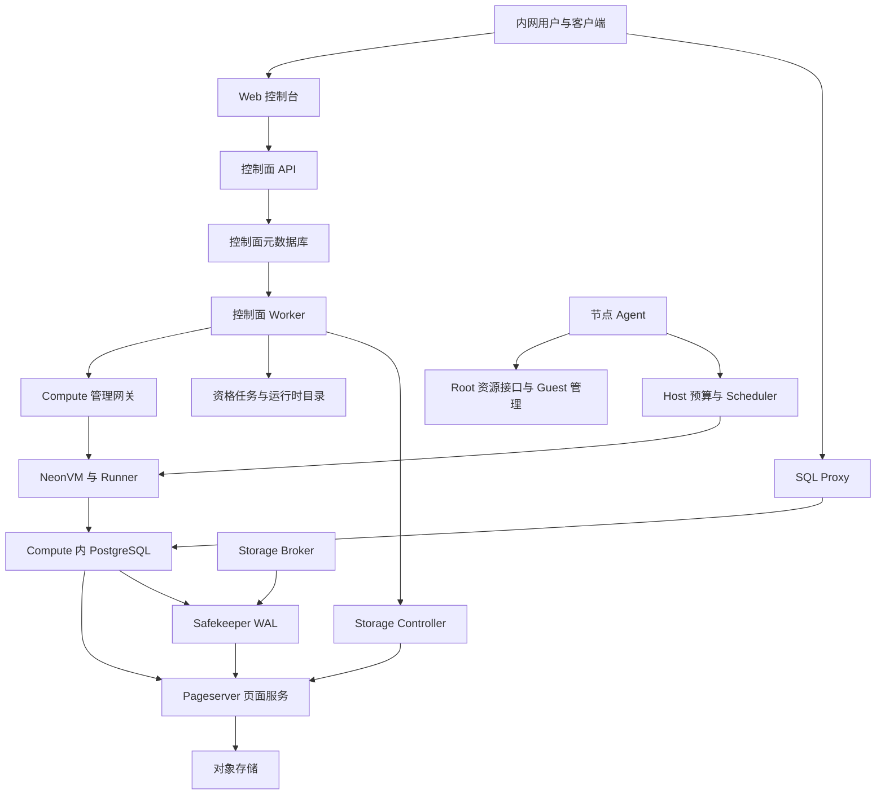

# 产品架构与责任边界

Neon 将计算和存储分离。Compute 内运行 PostgreSQL；Pageserver 提供页面并处理 WAL；Safekeeper 保全 WAL；Storage Controller 管理分片与节点；Broker 帮助存储成员发现。元数据库保存控制面业务对象和 Operation，不是租户数据库。

图中箭头表示主要业务依赖，不替代细粒度网络策略或完整认证协议。管理网关与 Agent 使用内部签发并校验的 TLS 身份；SQL 验收使用 `verify-full`。没有公网域名不影响内部服务 DNS 和内部证书。内置对象存储的 HTTP 必须显式允许；不能把它当成完整 TLS 或生产认证。

## 三类所有者

Helm 负责常驻 Deployment、DaemonSet、Service、RBAC、PVC 和声明式设置。站点入口只解决首次 PKI、凭据、当次 Service/Secret/Node/Lease 身份及循环依赖接线。它不替代原生 Host 预算协议或业务 Controller。

控制面负责租户、项目、分支、Compute 的公开操作及其幂等身份。Worker、NeonVM Controller、Scheduler、Agent、Root 与存储原所有者分别验证自己的状态；数据库副作用或内存变化不能靠改一份 manifest 证明。

平台运维负责集群、节点 KVM、CNI、存储实现、证书控制器、内网仓库和节点镜像信任。这些共享设施不属于产品卸载范围。

## 通用配置和资格边界

可替换输入包括站点名、区域、kubeconfig、集群 DNS 后缀、命名空间、仓库及项目、CA/只读认证、存储类和本地卷根目录、节点标签筛选与系统预留。生成器保留发行摘要，不把镜像改名当成构建成功。节点名称和 UID、Lease UID、Service UID、Secret UID、Host capacity/allocatable 在安装现场读取或新建，不写入复用模板。

当前可验收配置是 Linux/amd64、KVM、主 CNI、声明的本地持久存储、已资格认证的 PG17/PG18 运行规格。Host 合同支持 1..16 个合格节点；已完成现场证据为 5 个 worker。配置可替换不代表任意硬件、内核、CSI、外部 S3 或其他资源规格自动获得认证。使用这些扩展必须补实现和真实验收，不能放宽安全检查。

节点标签选择器先决定本次候选，再按实际 Node UID 建立可信 Host 集合。开放的放置条件不授予全局 Node PATCH。新节点持续登记及资格发布属于另一个完整流程，目前暂缓。

## MinIO 与初始化任务

标准方案只部署一个内置对象存储服务。`minio-init` 是一次初始化 bucket 的 Job，不是第二个对象存储服务。Job 与服务可以使用不同的专用镜像；两者都必须在当前内网仓库按摘要存在。初始化 Job 失败应检查其原 Pod 事件、镜像和原 Job 结果，不能重复安装另一套 MinIO。
